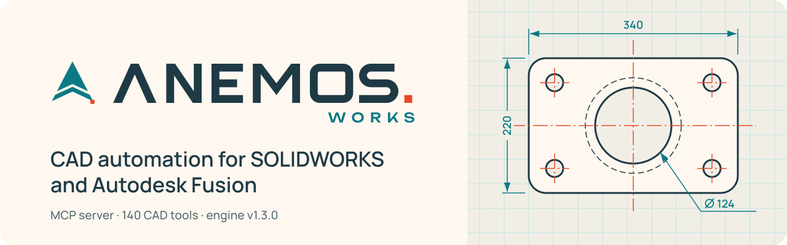

  

  [ English | <a href="README.ru.md">Русский</a> ] ·
  <a href="docs/DOWNLOADS.md">Downloads</a> ·
  <a href="docs/ROADMAP.md">Roadmap</a> ·
  <a href="docs/VALIDATION.md">Validation</a> ·
  <a href="https://github.com/pilotarbuza/anemosworks/issues">Issues</a>

AnemosWorks automates SOLIDWORKS and Autodesk Fusion. An MCP server gives an AI client tools for sketches, features, assemblies, drawings and geometry checks. A desktop app built on the same engine is in progress.

## Status

The CAD engine and the MCP server work (v1.3.0). The desktop app and its installer are still in development.

This repository holds the public side of the project: documentation, validation reports and, later, release downloads. The engine itself lives in a private repository.

## What it can do

- Parametric parts: 2D and 3D sketches, constraints, dimensions, extrudes, revolves, sweeps, lofts, fillets, chamfers and patterns.
- Assemblies: inserting components, standard mates and joints, fasteners, interference checks.
- Inspection and export: mass properties, bounding boxes, rebuild checks, export to STEP, IGES, STL and Parasolid.
- Sheet metal flanges and weldment profiles.
- Feature reconstruction: supported prismatic and revolved bodies are turned back into an editable feature tree, and the result is compared against the original geometry.
- 140 CAD tools over the standard Model Context Protocol.

Fusion covers 109 of the 128 shared CAD operations. Drawings, FEA studies and animations are limited by the Fusion platform for now; see [docs/VALIDATION.md](docs/VALIDATION.md).

## Two ways to use it

1. As an MCP server, a local tool provider for Claude Desktop, Cursor and other MCP clients.
2. As the AnemosWorks app (in progress): a desktop client with task history that finds running CAD sessions and binds tasks to the open document.

## Releases

Signed Windows installers will go out through [GitHub Releases](https://github.com/pilotarbuza/anemosworks/releases). Current state: [docs/DOWNLOADS.md](docs/DOWNLOADS.md).

## Author

Maksim Akhmadulin, [pilotarbuza.com](https://pilotarbuza.com)  
Bugs and ideas go to [GitHub Issues](https://github.com/pilotarbuza/anemosworks/issues).
