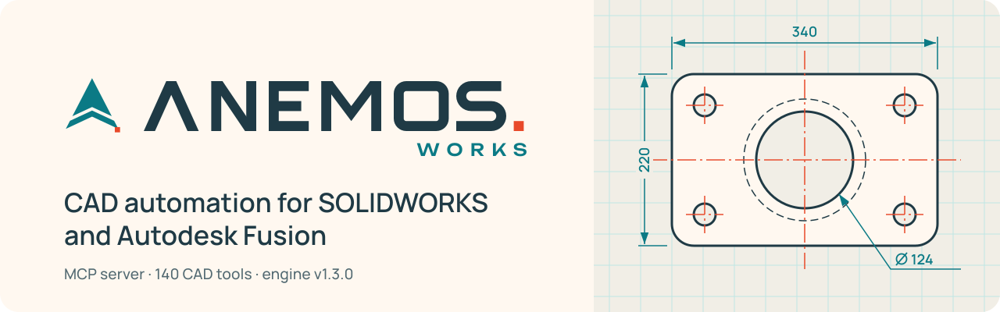

  

  [ <a href="README.md">English</a> | Русский ] ·
  <a href="docs/DOWNLOADS.ru.md">Загрузка</a> ·
  <a href="docs/ROADMAP.ru.md">Планы</a> ·
  <a href="docs/VALIDATION.ru.md">Проверки</a> ·
  <a href="https://github.com/pilotarbuza/anemosworks/issues">Обратная связь</a>

AnemosWorks автоматизирует работу в SOLIDWORKS и Autodesk Fusion. Через MCP-сервер ИИ-клиент получает инструменты для эскизов, элементов, сборок, чертежей и проверки геометрии. На том же ядре делается настольное приложение.

## Статус

CAD-ядро и MCP-сервер работают (версия 1.3.0). Приложение и установщик пока в разработке.

Здесь лежит публичная часть проекта: документация, отчеты о проверках, планы, а позже и релизы. Код коммерческого ядра хранится в закрытом репозитории.

## Что умеет

- Параметрические детали: 2D- и 3D-эскизы, взаимосвязи, размеры, бобышки, вырезы, вращение, скругления, фаски, массивы.
- Сборки: вставка компонентов, сопряжения, стандартный крепеж, проверка интерференции.
- Контроль и экспорт: масса, габариты, результат перестроения, экспорт в STEP, IGES, STL и Parasolid.
- Листовой металл и профили: фланцы, гибка кромок, стандартные сварные балки.
- Восстановление дерева: призматические тела и тела вращения превращаются в редактируемые элементы, результат сверяется с исходной геометрией.
- 140 инструментов для совместимых MCP-клиентов.

Во Fusion доступно 109 из 128 общих CAD-операций. С чертежами, прочностными расчетами и анимацией там пока есть ограничения самой платформы, подробности в [docs/VALIDATION.ru.md](docs/VALIDATION.ru.md).

## Как пользоваться

1. Как MCP-сервером: локальный набор инструментов для Claude Desktop, Cursor и других MCP-клиентов.
2. Через приложение AnemosWorks (в разработке): история задач, автоматический поиск запущенных CAD-сессий и привязка к открытому файлу.

## Релизы

Подписанный установщик для Windows появится в [GitHub Releases](https://github.com/pilotarbuza/anemosworks/releases), когда будет готов. Текущее состояние описано в [docs/DOWNLOADS.ru.md](docs/DOWNLOADS.ru.md).

## Автор

Максим Ахмадулин, [pilotarbuza.com](https://pilotarbuza.com)  
Вопросы и предложения: [GitHub Issues](https://github.com/pilotarbuza/anemosworks/issues)
