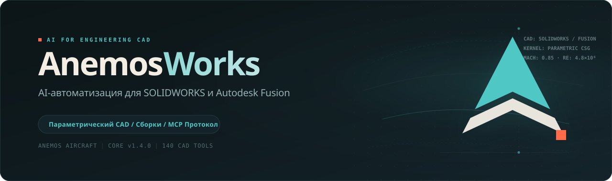

  

  [ <a href="README.md">English</a> | Русский ] ·
  <a href="docs/DOWNLOADS.ru.md">Загрузка</a> ·
  <a href="docs/ROADMAP.ru.md">Планы</a> ·
  <a href="docs/VALIDATION.ru.md">Проверки</a> ·
  <a href="https://github.com/pilotarbuza/anemosworks/issues">Обратная связь</a>

---

AnemosWorks — движок автоматизации для SOLIDWORKS и Autodesk Fusion. Предоставляет инструменты параметрического моделирования (эскизы, элементы, сборки, чертежи, проверки геометрии) через MCP-сервер и настольное приложение.

## Статус

CAD-ядро и MCP-сервер работают (версия 1.3.0). Настольное приложение и установщик находятся в разработке.

Этот репозиторий — публичная страница проекта: документация, отчёты валидации, планы и будущие релизы. Исходный код коммерческого ядра находится в закрытом репозитории.

## Возможности

- **Параметрические детали**: 2D/3D-эскизы, взаимосвязи, размеры, бобышки, вырезы, вращение, скругления, фаски, массивы.
- **Сборки**: вставка компонентов, сопряжения, стандартный крепёж, проверка интерференции.
- **Контроль и экспорт**: масса, габариты, результат перестроения, экспорт в STEP, IGES, STL, Parasolid.
- **Листовой металл и профили**: гибка кромок, фланцы, стандартные сварные балки.
- **Восстановление дерева**: распознавание призматических тел и тел вращения в редактируемые элементы с контролем геометрии.
- **Интерфейс MCP**: 140 инструментов для совместимых MCP-клиентов.

Fusion поддерживает 109 из 128 общих CAD-операций. Чертежи, прочностные расчёты и анимации во Fusion имеют платформенные ограничения. Подробнее: [docs/VALIDATION.ru.md](docs/VALIDATION.ru.md).

## Режимы работы

1. **MCP-сервер**: локальный провайдер инструментов для MCP-клиентов (Claude Desktop, Cursor и др.).
2. **Приложение AnemosWorks**: настольный интерфейс с историей задач, автоопределением сессий CAD и привязкой к активному файлу (в разработке).

## Релизы

После подготовки подписанный Windows-установщик появится в [GitHub Releases](https://github.com/pilotarbuza/anemosworks/releases). Подробнее: [docs/DOWNLOADS.ru.md](docs/DOWNLOADS.ru.md).

## Автор

Максим Ахмадулин — [pilotarbuza.com](https://pilotarbuza.com)  
Вопросы и предложения: [GitHub Issues](https://github.com/pilotarbuza/anemosworks/issues)
